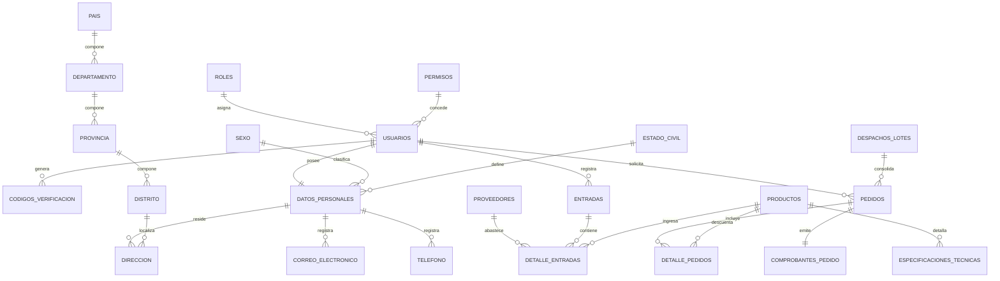

# TechStore — Manual y Diccionario de Base de Datos, DER y Sustentación 3FN

> **Propósito del documento:** Especificación técnica integral, arquitectura relacional, diccionario de datos exhaustivo (PK, FK, tipos, restricciones) y justificación teórica de formas normales (**1FN a 4FN**) del sistema **TechStore** para sustentación académica y exportación directa a PDF.  
> **Institución:** Universidad Tecnológica del Perú (UTP) · **Curso:** Desarrollo Full Stack (Sección 38344)  
> **Docente:** Ing. Jeyson Junior Ventura Aguilar  
> **Integrantes:** Gustavo Blas Asto Aiquipa & Diego Armando Caire Quino  
> **Motor de Base de Datos:** PostgreSQL 16 (Neon Tech Cloud / Local) · **Esquema:** `public` (23 Tablas Relacionadas)

---

## Índice General

1. [Visión General y Diagrama Entidad-Relación Global (DER)](#1-visión-general-y-diagrama-entidad-relación-global-der)
2. [Fundamentación y Aplicación Rigurosa de Formas Normales](#2-fundamentación-y-aplicación-rigurosa-de-formas-normales)
3. [Diccionario Exhaustivo de Datos (Las 23 Tablas del Sistema)](#3-diccionario-exhaustivo-de-datos-las-23-tablas-del-sistema)
   * 3.1. [Módulo 1: Seguridad, Acceso y Control](#31-módulo-1-seguridad-acceso-y-control)
   * 3.2. [Módulo 2: Identidad Ciudadana y Catálogos](#32-módulo-2-identidad-ciudadana-y-catálogos)
   * 3.3. [Módulo 3: Jerarquía Territorial y Geografía](#33-módulo-3-jerarquía-territorial-y-geografía)
   * 3.4. [Módulo 4: Catálogo de Mercadería y Ficha Técnica](#34-módulo-4-catálogo-de-mercadería-y-ficha-técnica)
   * 3.5. [Módulo 5: Abastecimiento, Almacén y Kardex](#35-módulo-5-abastecimiento-almacén-y-kardex)
   * 3.6. [Módulo 6: Ventas, Facturación Legal y Despachos](#36-módulo-6-ventas-facturación-legal-y-despachos)
4. [Matriz Maestra de Relaciones, Cardinalidades e Integridad Referencial](#4-matriz-maestra-de-relaciones-cardinalidades-e-integridad-referencial)
5. [Análisis de Decisiones de Diseño y Snapshot Transaccional](#5-análisis-de-decisiones-de-diseño-y-snapshot-transaccional)
6. [Guía de Sustentación para Evaluación de Cátedra](#6-guía-de-sustentación-para-evaluación-de-cátedra)

---

## 1. Visión General y Diagrama Entidad-Relación Global (DER)

El modelo relacional de **TechStore** ha sido diseñado bajo un enfoque de **alta cohesión y bajo acoplamiento**. Centraliza las operaciones del E-Commerce B2C, la administración de usuarios y la gestión de almacén con Kardex físico-valorizado, garantizando **cero tablas huérfanas** y total integridad referencial.

### 1.1 Diagrama Entidad-Relación (Mermaid ERD)



---

## 2. Fundamentación y Aplicación Rigurosa de Formas Normales

La base de datos satisface la normalización formal desde la Primera hasta la Cuarta Forma Normal, justificadas de acuerdo con la teoría de Edgar F. Codd y la cátedra del **Ing. Jeyson Ventura Aguilar**:

```
+-----------------------------------------------------------------------------------+
| PRIMERA FORMA NORMAL (1FN)                                                        |
| * Todos los atributos son atómicos (sin valores compuestos ni listas).            |
| * No existen grupos repetitivos (prohibido: telefono1, telefono2, correo1, etc.). |
+-----------------------------------------------------------------------------------+
                                         │
                                         ▼
+-----------------------------------------------------------------------------------+
| SEGUNDA FORMA NORMAL (2FN)                                                        |
| * Cumple 1FN.                                                                     |
| * Todo atributo no clave depende de forma completa de la clave primaria (PK).     |
| * Se eliminan dependencias parciales en tablas intermedias (Detalles de Venta).   |
+-----------------------------------------------------------------------------------+
                                         │
                                         ▼
+-----------------------------------------------------------------------------------+
| TERCERA FORMA NORMAL (3FN)                                                        |
| * Cumple 2FN.                                                                     |
| * Ningún atributo no clave depende transitivamente de la clave primaria.          |
| * Regla: Si A -> B y B -> C, C no debe estar en la tabla de A.                    |
| * Ejemplos clave: Cascada Geográfica y Desacoplamiento de Identidad.              |
+-----------------------------------------------------------------------------------+
                                         │
                                         ▼
+-----------------------------------------------------------------------------------+
| CUARTA FORMA NORMAL (4FN)                                                         |
| * Cumple 3FN (o BCNF).                                                            |
| * Se eliminan Dependencias Multivaluadas Independientes (MVD).                    |
| * Correos, teléfonos y direcciones viven en tablas hijas separadas.               |
+-----------------------------------------------------------------------------------+
```

### 2.1 Demostración de 3FN en Identidad y Contacto
* **Problema en modelos planos:** Guardar en `usuarios` el DNI, nombres, sexo, estado civil, teléfono y dirección.
* **Violación:** Si un usuario cambia su contraseña, se accede a la misma fila donde está su identidad civil. Además, si el distrito determina la provincia, se genera una dependencia transitiva ($\text{id\_usuario} \to \text{distrito} \to \text{departamento}$).
* **Solución Aplicada:**
  1. `usuarios` almacena únicamente credenciales técnicas y flags de autenticación.
  2. `datos_personales` aísla la persona física con relación 1:1.
  3. Los catálogos `sexo` y `estado_civil` eliminan redundancia textual.

### 2.2 Demostración de 4FN en Atributos Multivaluados
* **Problema:** Una persona puede tener 2 teléfonos (móvil y trabajo) y 2 correos (personal e institucional).
* **Violación de 4FN:** Si se colocan en `datos_personales`, se produciría una explosión combinatoria (producto cartesiano de 4 filas redundantes con los mismos nombres y DNI repetidos).
* **Solución Aplicada:** Tablas independientes `correo_electronico` y `telefono` con cardinalidad `1:N`.

### 2.3 Demostración de 3FN en la Cascada Geográfica
* **Cadena de Dependencia Funcional:**  
  $$\text{id\_direccion} \longrightarrow \text{id\_distrito} \longrightarrow \text{id\_provincia} \longrightarrow \text{id\_departamento} \longrightarrow \text{id\_pais}$$
* Cada entidad territorial depende **únicamente de su clave primaria inmediata**. Se elimina cualquier repetición de cadenas de texto de departamentos o países en miles de direcciones de clientes.

### 2.4 Demostración de 3FN en Catálogo: Ficha Técnica sin Valores Nulos
* **Problema Clásico de Tiendas Virtuales:** Una tabla `productos` con 30 columnas (`ram`, `almacenamiento`, `watts_carga`, `tasa_refresco`, `cancelacion_ruido`).
* **Consecuencia:** Para unos audífonos, 20 columnas quedan en `NULL`. Para una mochila, 28 columnas quedan en `NULL`.
* **Solución Aplicada:** Tabla relacional `especificaciones_tecnicas (id_producto, caracteristica, valor)`:
  * Atomicidad total.
  * Cero columnas nulas.
  * Flexibilidad absoluta para incorporar nuevas categorías (monitores, smartwatches, consolas) sin alterar la estructura física DDL de la base de datos.

---

## 3. Diccionario Exhaustivo de Datos (Las 23 Tablas del Sistema)

---

### 3.1 Módulo 1: Seguridad, Acceso y Control

#### Tabla: `usuarios`
Centraliza las credenciales, mecanismos de defensa contra fuerza bruta y ciclo de vida de la cuenta.

| Campo | Tipo PostgreSQL | Restricción | Descripción | Tipo de Dato |
| :--- | :--- | :--- | :--- | :--- |
| `id_usuario` | `SERIAL / INT` | **PK**, NOT NULL | Identificador único del usuario | Seguridad / Clave |
| `nombre_usuario` | `VARCHAR(50)` | UNIQUE, NOT NULL | Nombre de usuario o correo de acceso | Autenticación |
| `contrasena` | `VARCHAR(255)` | NOT NULL | Clave cifrada con BCrypt (costo 10) | Seguridad |
| `rol_id` | `INT` | **FK** (`rol.rol_id`), NOT NULL | Nivel jerárquico asignado | Control RBAC |
| `permiso_id` | `INT` | **FK** (`permiso.permiso_id`), NULL | Permiso especial complementario | Control RBAC |
| `ultimo_acceso` | `TIMESTAMP` | NULL | Fecha y hora del último inicio de sesión | Auditoría |
| `intentos_fallidos`| `INT` | NOT NULL, DEFAULT `0` | Contador para bloqueo progresivo | Seguridad |
| `bloqueado` | `BOOLEAN` | NOT NULL, DEFAULT `FALSE` | Bandera de bloqueo de cuenta | Seguridad |
| `bloqueado_hasta` | `TIMESTAMP` | NULL | Expiración de penalización temporal | Seguridad |
| `nivel_bloqueo` | `INT` | NOT NULL, DEFAULT `0` | Escalamiento de castigo (1min, 5min, 15min) | Seguridad |
| `token_recuperacion`| `VARCHAR(255)`| NULL | Token para restablecimiento de contraseña | Seguridad |
| `requiere_cambio_password`| `BOOLEAN`| NOT NULL, DEFAULT `FALSE`| Obliga cambio en primer acceso | Seguridad |
| `correo_verificado`| `BOOLEAN` | NULL | Estado de verificación por código | Seguridad |
| `two_factor_activo`| `BOOLEAN` | NOT NULL, DEFAULT `FALSE`| Requiere código 2FA al loguear | Seguridad |
| `estado` | `VARCHAR(15)` | NOT NULL, DEFAULT `'Activo'` | Estado operativo (`Activo`, `Inactivo`) | Control |
| `fecha_creacion` | `TIMESTAMP` | NOT NULL, DEFAULT `NOW()` | Fecha de registro en el sistema | Auditoría |
| `fecha_actualizacion`| `TIMESTAMP`| NULL | Fecha de última modificación | Auditoría |
| `usuario_registro` | `VARCHAR(50)`| NOT NULL, DEFAULT `'SISTEMA'`| Usuario o proceso que creó la fila | Auditoría |

#### Tabla: `rol`
Catálogo maestro de roles del sistema.

| Campo | Tipo | Restricción | Descripción |
| :--- | :--- | :--- | :--- |
| `rol_id` | `SERIAL / INT` | **PK**, NOT NULL | Identificador único del rol |
| `nombre_rol` | `VARCHAR(50)` | UNIQUE, NOT NULL | Nombre oficial (`ADMINISTRADOR`, `ALMACEN`, `CLIENTE`) |
| `descripcion` | `VARCHAR(200)` | NULL | Alcance y funciones asignadas al rol |

#### Tabla: `permiso`
Catálogo de permisos de granularidad fina.

| Campo | Tipo | Restricción | Descripción |
| :--- | :--- | :--- | :--- |
| `permiso_id` | `SERIAL / INT` | **PK**, NOT NULL | Identificador único del permiso |
| `nombre_permiso` | `VARCHAR(50)` | UNIQUE, NOT NULL | Nombre técnico del privilegio |
| `descripcion` | `VARCHAR(200)` | NULL | Detalle de las acciones permitidas |

#### Tabla: `codigos_verificacion`
Registro de contraseñas de un solo uso (OTP) para validación de cuenta y recuperación.

| Campo | Tipo | Restricción | Descripción |
| :--- | :--- | :--- | :--- |
| `id_codigo` | `SERIAL / INT` | **PK**, NOT NULL | Clave primaria del intento de verificación |
| `id_usuario` | `INT` | **FK** (`usuarios.id_usuario`), NOT NULL | Usuario al que se le emitió el código |
| `codigo_hash` | `VARCHAR(255)` | NOT NULL | Código numérico cifrado con Hash seguro |
| `correo_destino` | `VARCHAR(120)` | NOT NULL | Buzón donde se remitió el OTP |
| `desafio_token` | `VARCHAR(255)` | NULL | Token de validación de sesión de recuperación |
| `proposito` | `VARCHAR(40)` | NOT NULL | Motivo (`LOGIN_2FA`, `RECUPERAR_PASSWORD`, etc.) |
| `fecha_expiracion`| `TIMESTAMP` | NOT NULL | Límite temporal de vigencia (ej: 15 minutos) |
| `usado` | `BOOLEAN` | NOT NULL, DEFAULT `FALSE` | Marca si ya fue canjeado con éxito |
| `intentos_fallidos`| `INT` | NOT NULL, DEFAULT `0` | Fallos ingresando el código OTP |
| `max_intentos` | `INT` | NOT NULL, DEFAULT `3` | Límite antes de invalidar el código |
| `estado` | `VARCHAR(20)` | NOT NULL, DEFAULT `'PENDIENTE'`| `PENDIENTE`, `USADO`, `EXPIRADO`, `BLOQUEADO` |
| `fecha_creacion` | `TIMESTAMP` | NOT NULL, DEFAULT `NOW()` | Momento de generación del OTP |

---

### 3.2 Módulo 2: Identidad Ciudadana y Catálogos

#### Tabla: `datos_personales`
Centraliza la identidad civil del titular, desacoplada de la seguridad de la cuenta.

| Campo | Tipo | Restricción | Descripción |
| :--- | :--- | :--- | :--- |
| `id_datos_personales`| `SERIAL / INT` | **PK**, NOT NULL | Identificador del registro civil |
| `id_usuario` | `INT` | **FK** (`usuarios.id_usuario`), UNIQUE, NOT NULL | Enlace unívoco 1:1 con la cuenta |
| `nombres` | `VARCHAR(80)` | NOT NULL | Nombres del ciudadano según RENIEC |
| `apellidos` | `VARCHAR(80)` | NOT NULL | Apellidos paterno y materno |
| `dni` | `VARCHAR(15)` | UNIQUE, NOT NULL | Documento Nacional de Identidad oficial |
| `id_sexo` | `INT` | **FK** (`sexo.id_sexo`), NOT NULL | Referencia al catálogo de género |
| `id_estado_civil` | `INT` | **FK** (`estado_civil.id_estado_civil`), NOT NULL | Referencia al catálogo de estado civil |

#### Tabla: `sexo`
Catálogo maestro cerrado de opciones de género.

| Campo | Tipo | Restricción | Descripción |
| :--- | :--- | :--- | :--- |
| `id_sexo` | `SERIAL / INT` | **PK**, NOT NULL | Identificador del sexo |
| `descripcion` | `VARCHAR(30)` | NOT NULL | `Masculino`, `Femenino`, `No Especifica` |

#### Tabla: `estado_civil`
Catálogo maestro de estados civiles.

| Campo | Tipo | Restricción | Descripción |
| :--- | :--- | :--- | :--- |
| `id_estado_civil` | `SERIAL / INT` | **PK**, NOT NULL | Identificador del estado civil |
| `descripcion` | `VARCHAR(30)` | NOT NULL | `Soltero(a)`, `Casado(a)`, `Viudo(a)`, etc. |

#### Tabla: `correo_electronico`
Entidad multivaluada para trazabilidad de correos de contacto.

| Campo | Tipo | Restricción | Descripción |
| :--- | :--- | :--- | :--- |
| `id_correo` | `SERIAL / INT` | **PK**, NOT NULL | Identificador del correo |
| `id_datos_personales`| `INT` | **FK** (`datos_personales`), NOT NULL | Enlace con la persona natural |
| `correo_electronico` | `VARCHAR(100)`| NOT NULL | Dirección de correo electrónico |
| `tipo_correo` | `VARCHAR(30)` | NULL | Clasificación (`Personal`, `Laboral`, `Facturación`) |

#### Tabla: `telefono`
Entidad multivaluada de líneas telefónicas.

| Campo | Tipo | Restricción | Descripción |
| :--- | :--- | :--- | :--- |
| `id_telefono` | `SERIAL / INT` | **PK**, NOT NULL | Identificador del registro telefónico |
| `id_datos_personales`| `INT` | **FK** (`datos_personales`), NOT NULL | Enlace con la persona natural |
| `numero_telefono` | `VARCHAR(20)` | NOT NULL | Dígitos numéricos del teléfono |
| `tipo_telefono` | `VARCHAR(30)` | NULL | `Móvil`, `Fijo`, `WhatsApp` |

#### Tabla: `direccion`
Residencias y domicilios registrados por la persona.

| Campo | Tipo | Restricción | Descripción |
| :--- | :--- | :--- | :--- |
| `id_direccion` | `SERIAL / INT` | **PK**, NOT NULL | Identificador único del domicilio |
| `id_datos_personales`| `INT` | **FK** (`datos_personales`), NOT NULL | Propietario de la dirección |
| `id_distrito` | `INT` | **FK** (`distrito.id_distrito`), NOT NULL | Ubicación geográfica en 3FN |
| `calle_avenida` | `VARCHAR(150)`| NOT NULL | Nombre de la vía pública |
| `numero` | `VARCHAR(20)` | NULL | Numeración municipal |
| `piso` | `VARCHAR(10)` | NULL | Nivel, dpto o interior |
| `referencia` | `VARCHAR(200)`| NULL | Datos para facilitar la ubicación |
| `tipo_direccion` | `VARCHAR(40)` | NULL | `Domicilio`, `Oficina`, `Almacén` |

---

### 3.3 Módulo 3: Jerarquía Territorial y Geografía

#### Tabla: `pais`
| Campo | Tipo | Restricción | Descripción |
| :--- | :--- | :--- | :--- |
| `id_pais` | `SERIAL / INT` | **PK**, NOT NULL | Identificador del país |
| `nombre_pais` | `VARCHAR(80)` | NOT NULL | Nombre soberano (`Perú`) |

#### Tabla: `departamento`
| Campo | Tipo | Restricción | Descripción |
| :--- | :--- | :--- | :--- |
| `id_departamento` | `SERIAL / INT` | **PK**, NOT NULL | Identificador del departamento / región |
| `nombre_departamento`| `VARCHAR(80)`| NOT NULL | Nombre regional (`Lima`, `Arequipa`, `Cusco`) |
| `id_pais` | `INT` | **FK** (`pais.id_pais`), NOT NULL | País de pertenencia |

#### Tabla: `provincia`
| Campo | Tipo | Restricción | Descripción |
| :--- | :--- | :--- | :--- |
| `id_provincia` | `SERIAL / INT` | **PK**, NOT NULL | Identificador de la provincia |
| `nombre_provincia` | `VARCHAR(80)` | NOT NULL | Nombre provincial (`Lima`, `Callao`, etc.) |
| `id_departamento` | `INT` | **FK** (`departamento`), NOT NULL | Departamento de pertenencia |

#### Tabla: `distrito`
| Campo | Tipo | Restricción | Descripción |
| :--- | :--- | :--- | :--- |
| `id_distrito` | `SERIAL / INT` | **PK**, NOT NULL | Identificador del distrito |
| `nombre_distrito` | `VARCHAR(80)` | NOT NULL | Nombre distrital (`San Juan de Lurigancho`) |
| `id_provincia` | `INT` | **FK** (`provincia.id_provincia`), NOT NULL | Provincia de pertenencia |

---

### 3.4 Módulo 4: Catálogo de Mercadería y Ficha Técnica

#### Tabla: `productos`
Almacena los artículos tecnológicos comercializados en la tienda.

| Campo | Tipo | Restricción | Descripción |
| :--- | :--- | :--- | :--- |
| `id_producto` | `SERIAL / INT` | **PK**, NOT NULL | Identificador único del producto |
| `nombre` | `VARCHAR(200)`| NOT NULL | Nombre comercial y modelo del artículo |
| `categoria` | `VARCHAR(50)` | NOT NULL | Categoría (`Smartphones`, `Laptops`, `Audio`) |
| `marca` | `VARCHAR(100)`| NOT NULL, DEFAULT `'Genérico'` | Marca del fabricante (`Apple`, `Sony`, etc.) |
| `precio` | `NUMERIC(12,2)`| NOT NULL | Precio de venta oficial al público (PVP) |
| `stock` | `INT` | NOT NULL, DEFAULT `0` | Cantidad física disponible en almacén |
| `vendidos` | `INT` | NOT NULL, DEFAULT `0` | Unidades acumuladas vendidas |
| `imagen` | `VARCHAR(500)`| NULL | URL pública de la imagen en Cloudinary |
| `descripcion` | `TEXT` | NULL | Ficha descriptiva y comercial |
| `activo` | `BOOLEAN` | NOT NULL, DEFAULT `TRUE` | Estado lógico (baja lógica = `FALSE`) |
| `fecha_creacion` | `TIMESTAMP` | NOT NULL, DEFAULT `NOW()` | Fecha de registro |
| `fecha_actualizacion`| `TIMESTAMP`| NULL | Fecha de última edición |
| `usuario_registro` | `VARCHAR(50)`| NOT NULL, DEFAULT `'SISTEMA'`| Auditoría de usuario |

#### Tabla: `especificaciones_tecnicas`
Atributos técnicos normalizados en **3FN** (Cero columnas nulas).

| Campo | Tipo | Restricción | Descripción |
| :--- | :--- | :--- | :--- |
| `id_especificacion` | `SERIAL / INT`| **PK**, NOT NULL | Identificador de la especificación |
| `id_producto` | `INT` | **FK** (`productos.id_producto`), NOT NULL | Producto al que pertenece |
| `caracteristica` | `VARCHAR(100)`| NOT NULL | Nombre del atributo (`Memoria RAM`, `Batería`) |
| `valor` | `VARCHAR(150)`| NOT NULL | Magnitud y valor (`16 GB DDR4`, `5000 mAh`) |
| `activo` | `BOOLEAN` | NOT NULL, DEFAULT `TRUE` | Vigencia de la característica |
| `fecha_creacion` | `TIMESTAMP` | NOT NULL, DEFAULT `NOW()` | Momento del registro |
| `fecha_actualizacion`| `TIMESTAMP`| NULL | Modificación |
| `usuario_registro` | `VARCHAR(50)`| NOT NULL, DEFAULT `'SISTEMA'`| Auditoría |

---

### 3.5 Módulo 5: Abastecimiento, Almacén y Kardex

#### Tabla: `proveedores`
Empresas proveedoras registradas ante SUNAT.

| Campo | Tipo | Restricción | Descripción |
| :--- | :--- | :--- | :--- |
| `id_proveedor` | `SERIAL / INT` | **PK**, NOT NULL | Clave primaria del proveedor |
| `ruc` | `VARCHAR(11)` | UNIQUE, NOT NULL | Registro Único de Contribuyentes (11 dígitos) |
| `razon_social` | `VARCHAR(150)`| NOT NULL | Nombre legal de la empresa según SUNAT |
| `contacto` | `VARCHAR(100)`| NULL | Ejecutivo comercial asignado |
| `telefono` | `VARCHAR(20)` | NULL | Teléfono corporativo |
| `correo` | `VARCHAR(100)`| NULL | Correo de cotizaciones y pedidos |
| `direccion` | `VARCHAR(200)`| NULL | Domicilio fiscal |
| `activo` | `BOOLEAN` | NOT NULL, DEFAULT `TRUE` | Habilitado para órdenes de compra |
| `fecha_creacion` | `TIMESTAMP` | NOT NULL, DEFAULT `NOW()` | Auditoría de creación |
| `fecha_actualizacion`| `TIMESTAMP`| NULL | Auditoría de actualización |

#### Tabla: `entradas`
Cabecera del registro de abastecimiento que alimenta el Kardex de ingresos.

| Campo | Tipo | Restricción | Descripción |
| :--- | :--- | :--- | :--- |
| `id_entrada` | `SERIAL / INT` | **PK**, NOT NULL | Identificador único de la entrada |
| `id_usuario` | `INT` | **FK** (`usuarios.id_usuario`), NOT NULL | Empleado de almacén que recepcionó |
| `fecha` | `TIMESTAMP` | NOT NULL, DEFAULT `NOW()` | Fecha y hora de recepción física |

#### Tabla: `detalle_entradas`
Ítems individuales ingresados, con su costo de adquisición unitario.

| Campo | Tipo | Restricción | Descripción |
| :--- | :--- | :--- | :--- |
| `id_detalle_entrada`| `SERIAL / INT`| **PK**, NOT NULL | Clave primaria del renglón de entrada |
| `id_entrada` | `INT` | **FK** (`entradas.id_entrada`), NOT NULL | Factura/guía de ingreso asociada |
| `producto_id` | `INT` | **FK** (`productos.id_producto`), NOT NULL | Producto abastecido (suma stock) |
| `id_proveedor` | `INT` | **FK** (`proveedores`), NULL | Proveedor que vendió el ítem |
| `nombre` | `VARCHAR(200)`| NOT NULL | Nombre histórico del ítem recibido |
| `cantidad` | `INT` | NOT NULL | Unidades que ingresaron al almacén |
| `costo_unitario` | `NUMERIC(12,2)`| NOT NULL | Costo de compra unitario pagado |

---

### 3.6 Módulo 6: Ventas, Facturación Legal y Despachos

#### Tabla: `pedidos`
Cabecera transaccional de compras realizadas por los clientes.

| Campo | Tipo | Restricción | Descripción |
| :--- | :--- | :--- | :--- |
| `id_pedido` | `SERIAL / INT` | **PK**, NOT NULL | Identificador unívoco del pedido |
| `numero` | `VARCHAR(50)` | UNIQUE, NOT NULL | Código visible de orden (`ORD-0001`) |
| `id_usuario` | `INT` | **FK** (`usuarios.id_usuario`), NOT NULL | Cliente comprador |
| `id_despacho_lote`| `INT` | **FK** (`despachos_lotes`), NULL | Lote logístico donde viaja el pedido |
| `total` | `NUMERIC(12,2)`| NOT NULL | Importe monetario total de la orden |
| `costo_envio` | `NUMERIC(12,2)`| NOT NULL, DEFAULT `0` | Flete calculado según modalidad |
| `estado` | `VARCHAR(30)` | NOT NULL | Ciclo (`PENDIENTE`, `PAGADO`, `EN_CAMINO`, `ENTREGADO`) |
| `estado_pago` | `VARCHAR(30)` | NOT NULL | Estado del cobro (`PENDIENTE`, `VERIFICADO`) |
| `metodo_pago` | `VARCHAR(30)` | NOT NULL | `TRANSFERENCIA`, `YAPE`, `TARJETA` |
| `codigo_operacion_pago`| `VARCHAR(60)`| NULL | N° de transacción bancaria |
| `comprobante_pago_url` | `VARCHAR(500)`| NULL | Foto del voucher de pago en Cloudinary |
| `usuario_confirmo_pago`| `VARCHAR(50)` | NULL | Admin que verificó el abono bancario |
| `tipo_entrega` | `VARCHAR(20)` | NOT NULL | `ENVIO_DOMICILIO`, `RECOJO_TIENDA` |
| `celular_contacto`| `VARCHAR(20)` | NULL | Teléfono Snapshot para delivery |
| `correo_contacto` | `VARCHAR(100)`| NULL | Correo Snapshot de notificaciones |
| `direccion_envio`| `VARCHAR(200)`| NULL | Dirección física Snapshot de entrega |
| `distrito_envio` | `VARCHAR(80)` | NULL | Distrito de entrega para ruta |
| `referencia_envio`| `VARCHAR(200)`| NULL | Datos de referencia para el transportista |
| `fecha` | `TIMESTAMP` | NOT NULL, DEFAULT `NOW()` | Fecha y hora de creación de la compra |
| `fecha_confirmacion_pago`| `TIMESTAMP`| NULL | Momento en que el admin validó el pago |
| `fecha_procesando`| `TIMESTAMP` | NULL | Momento en que pasó a empaque/picking |
| `fecha_envio` | `TIMESTAMP` | NULL | Momento en que salió con el repartidor |
| `fecha_entrega` | `TIMESTAMP` | NULL | Momento de entrega final al cliente |

#### Tabla: `detalle_pedidos`
Desglose de productos comprados en cada orden.

| Campo | Tipo | Restricción | Descripción |
| :--- | :--- | :--- | :--- |
| `id_detalle_pedido`| `SERIAL / INT` | **PK**, NOT NULL | Clave primaria del renglón de pedido |
| `id_pedido` | `INT` | **FK** (`pedidos.id_pedido`), NOT NULL | Pedido cabecera asociado |
| `producto_id` | `INT` | **FK** (`productos.id_producto`), NOT NULL | Producto vendido (descuenta stock) |
| `nombre` | `VARCHAR(200)` | NOT NULL | Nombre Snapshot del producto |
| `precio_unitario`| `NUMERIC(12,2)` | NOT NULL | Precio de venta unitario congelado |
| `cantidad` | `INT` | NOT NULL | Cantidad de unidades adquiridas |
| `imagen` | `VARCHAR(300)` | NULL | Foto miniatura del ítem vendido |

#### Tabla: `comprobantes_pedido`
Documento tributario formal generado para la transacción (Facturación SUNAT).

| Campo | Tipo | Restricción | Descripción |
| :--- | :--- | :--- | :--- |
| `id_comprobante` | `SERIAL / INT` | **PK**, NOT NULL | Identificador del comprobante legal |
| `id_pedido` | `INT` | **FK** (`pedidos.id_pedido`), UNIQUE, NOT NULL | Orden de venta amparada (Relación 1:1) |
| `tipo` | `VARCHAR(20)` | NOT NULL | Tipo de comprobante (`BOLETA`, `FACTURA`) |
| `documento` | `VARCHAR(20)` | NOT NULL | DNI (8 dígitos) o RUC (11 dígitos) |
| `nombre_razon_social`| `VARCHAR(150)`| NOT NULL | Nombres del cliente o Razón Social empresa |
| `direccion_fiscal`| `VARCHAR(200)` | NULL | Domicilio legal para Facturas |
| `subtotal` | `NUMERIC(12,2)` | NOT NULL | Base imponible (Total / 1.18) |
| `igv` | `NUMERIC(12,2)` | NOT NULL | Impuesto General a las Ventas (18%) |
| `total` | `NUMERIC(12,2)` | NOT NULL | Importe total liquidado |

#### Tabla: `despachos_lotes`
Consolidación logística de pedidos agrupados para salida vehicular.

| Campo | Tipo | Restricción | Descripción |
| :--- | :--- | :--- | :--- |
| `id_despacho` | `SERIAL / INT` | **PK**, NOT NULL | Identificador del despacho |
| `codigo_lote` | `VARCHAR(50)` | UNIQUE, NOT NULL | Código del lote logístico (`LOTE-2026-001`) |
| `conductor` | `VARCHAR(100)` | NOT NULL | Chofer asignado para la ruta |
| `empresa_transporte`| `VARCHAR(100)`| NOT NULL | Courier o flota propia |
| `placa_vehiculo` | `VARCHAR(20)` | NOT NULL | Matrícula de la unidad de transporte |
| `numero_guia_remision`| `VARCHAR(50)`| NULL | Guía de Remisión Remitente (SUNAT) |
| `estado` | `VARCHAR(30)` | NOT NULL | `PREPARANDO`, `EN_TRANSITO`, `FINALIZADO` |
| `fecha_despacho` | `TIMESTAMP` | NULL | Momento de salida del almacén |
| `observaciones` | `TEXT` | NULL | Incidencias de la ruta |
| `fecha_creacion` | `TIMESTAMP` | NOT NULL, DEFAULT `NOW()` | Auditoría de creación |
| `fecha_actualizacion`| `TIMESTAMP`| NULL | Auditoría de actualización |
| `usuario_registro` | `VARCHAR(50)` | NOT NULL | Empleado logístico que despachó |

---

## 4. Matriz Maestra de Relaciones, Cardinalidades e Integridad Referencial

| Tabla Origen (Hija) | Columna FK | Tabla Destino (Padre) | Columna PK | Cardinalidad | Regla ON DELETE | Justificación de Negocio |
| :--- | :--- | :--- | :--- | :---: | :---: | :--- |
| `usuarios` | `rol_id` | `rol` | `rol_id` | N : 1 | RESTRICT | Ningún usuario puede quedar sin rol RBAC asignado. |
| `usuarios` | `permiso_id` | `permiso` | `permiso_id` | N : 1 | SET NULL | Permisos individuales complementarios son opcionales. |
| `codigos_verificacion`| `id_usuario` | `usuarios` | `id_usuario` | N : 1 | CASCADE | Si se elimina el usuario, expiran sus códigos OTP. |
| `datos_personales` | `id_usuario` | `usuarios` | `id_usuario` | 1 : 1 | CASCADE | Un usuario tiene un único expediente civil ciudadano. |
| `datos_personales` | `id_sexo` | `sexo` | `id_sexo` | N : 1 | RESTRICT | El catálogo de sexo no puede eliminarse en cascada. |
| `datos_personales` | `id_estado_civil` | `estado_civil` | `id_estado_civil` | N : 1 | RESTRICT | Garantiza consistencia en el estado civil civil. |
| `correo_electronico`| `id_datos_personales`| `datos_personales`| `id_datos_personales`| N : 1 | CASCADE | Borrado en cascada al eliminar el titular. |
| `telefono` | `id_datos_personales`| `datos_personales`| `id_datos_personales`| N : 1 | CASCADE | Borrado en cascada al eliminar el titular. |
| `direccion` | `id_datos_personales`| `datos_personales`| `id_datos_personales`| N : 1 | CASCADE | Borrado en cascada de domicilios del titular. |
| `direccion` | `id_distrito` | `distrito` | `id_distrito` | N : 1 | RESTRICT | Integridad territorial: distritos son inmutables. |
| `distrito` | `id_provincia` | `provincia` | `id_provincia` | N : 1 | RESTRICT | Jerarquía política territorial del INEI. |
| `provincia` | `id_departamento` | `departamento` | `id_departamento` | N : 1 | RESTRICT | Jerarquía política territorial del INEI. |
| `departamento` | `id_pais` | `pais` | `id_pais` | N : 1 | RESTRICT | Jerarquía política territorial del INEI. |
| `especificaciones_tecnicas`| `id_producto` | `productos` | `id_producto` | N : 1 | CASCADE | Si el producto se borra, se purgan sus atributos. |
| `entradas` | `id_usuario` | `usuarios` | `id_usuario` | N : 1 | RESTRICT | Auditoría de qué almacenero recepcionó mercadería. |
| `detalle_entradas` | `id_entrada` | `entradas` | `id_entrada` | N : 1 | CASCADE | Los ítems componen la factura/guía de entrada. |
| `detalle_entradas` | `producto_id` | `productos` | `id_producto` | N : 1 | RESTRICT | Kardex: no se puede borrar producto con entradas. |
| `detalle_entradas` | `id_proveedor` | `proveedores` | `id_proveedor` | N : 1 | RESTRICT | Asocia formalmente el abastecedor al Kardex. |
| `pedidos` | `id_usuario` | `usuarios` | `id_usuario` | N : 1 | RESTRICT | Un usuario con ventas registradas no puede purgarse. |
| `pedidos` | `id_despacho_lote` | `despachos_lotes` | `id_despacho` | N : 1 | SET NULL | El pedido puede estar aún sin asignar a camión. |
| `detalle_pedidos` | `id_pedido` | `pedidos` | `id_pedido` | N : 1 | CASCADE | Elimina el detalle si la orden no confirmada se purga. |
| `detalle_pedidos` | `producto_id` | `productos` | `id_producto` | N : 1 | RESTRICT | Kardex: no se puede borrar producto con ventas. |
| `comprobantes_pedido`| `id_pedido` | `pedidos` | `id_pedido` | 1 : 1 | RESTRICT | Validez tributaria SUNAT: un comprobante por orden. |

---

## 5. Análisis de Decisiones de Diseño y Snapshot Transaccional

### 5.1 El Principio de Snapshot Histórico en Pedidos
En auditoría de bases de datos surge la pregunta:  
*¿Por qué la tabla `pedidos` almacena `direccion_envio`, `celular_contacto` y `distrito_envio` en texto plano en lugar de apuntar por FK a la tabla `direccion`?*

**Justificación de Ingeniería:**
1. **Inmutabilidad Transaccional:** Si un cliente compra en Enero y en Junio se muda y edita su dirección en su perfil a otra ciudad, **un pedido con FK histórica mutaría retroactivamente**, corrompiendo la auditoría de despacho y entrega.
2. **Requisito Tributario y de Entrega:** El pedido congela la fotografía (*snapshot*) de las condiciones exactas pactadas al momento de pagar.

### 5.2 Desacoplamiento de Personas Jurídicas (Empresas B2B con RUC)
La tabla `comprobantes_pedido` contiene `documento`, `nombre_razon_social` y `direccion_fiscal`:
* Una empresa con **RUC 20** (ej: *Tech Innovations S.A.C.*) no es una persona natural: **no tiene DNI, ni sexo, ni estado civil**.
* Al desacoplar el comprobante en su propia entidad 1:1, TechStore permite que un usuario operador realice compras corporativas con Factura sin violentar la integridad de la tabla `datos_personales`.

---

## 6. Guía de Sustentación para Evaluación de Cátedra

Esta sección reúne las respuestas modelo ante las preguntas técnicas más rigurosas del **Ing. Jeyson Ventura Aguilar**:

#### 1. ¿Cómo se demuestra que el sistema cumple con la Tercera Forma Normal (3FN)?
> *"Profesor, se demuestra porque hemos erradicado todas las dependencias transitivas:  
> 1. Las direcciones no almacenan los nombres de distrito ni departamento como texto plano; escalan a través de claves foráneas en la jerarquía `distrito -> provincia -> departamento -> pais`, donde cada entidad depende exclusivamente de su clave primaria.  
> 2. Las credenciales de seguridad (`usuarios`) están aisladas de la identidad ciudadana (`datos_personales`) y de los catálogos maestros (`rol`, `sexo`, `estado_civil`), evitando cualquier tipo de redundancia o anomalía de actualización."*

#### 2. ¿Por qué las tablas de contacto (`correo_electronico`, `telefono`) están en 4FN?
> *"Porque resuelven dependencias multivaluadas independientes (MVD). Si almacenáramos los múltiples correos y teléfonos en `datos_personales`, se violaría 1FN (múltiples columnas) o se produciría un producto cartesiano espurio de combinaciones. La Cuarta Forma Normal exige aislar cada hecho multivaluado independiente en su propia tabla con cardinalidad 1:N."*

#### 3. ¿Cómo se relaciona el Kardex de Almacén con las Ventas?
> *"A través de la entidad central `productos`:  
> * **Entradas (Ingresos):** La mercadería adquirida a `proveedores` ingresa mediante `entradas` y `detalle_entradas`, sumando stock físico y registrando el costo de compra unitario.  
> * **Salidas (Ventas):** El cliente compra mediante `pedidos` y `detalle_pedidos`, restando unidades físicas del stock y congelando el precio de venta unitario al que se liquidó la operación.  
> Ambas tablas hijas tienen Foreign Key estricta (`RESTRICT`) hacia `productos`, garantizando que ningún ítem con historial comercial pueda ser eliminado de la base de datos."*

#### 4. ¿Por qué la ficha técnica se modeló en `especificaciones_tecnicas` y no como columnas en `productos`?
> *"Porque aplicar 3FN en un catálogo heterogéneo (celulares, laptops, audífonos, accesorios) exige evitar el antipatrón de columnas dispersas con valores nulos masivos (*sparse columns*). Con la relación 1:N `(id_producto, caracteristica, valor)` logramos atomicidad total, cero valores nulos y escalabilidad inmediata para cualquier nueva categoría de producto."*
