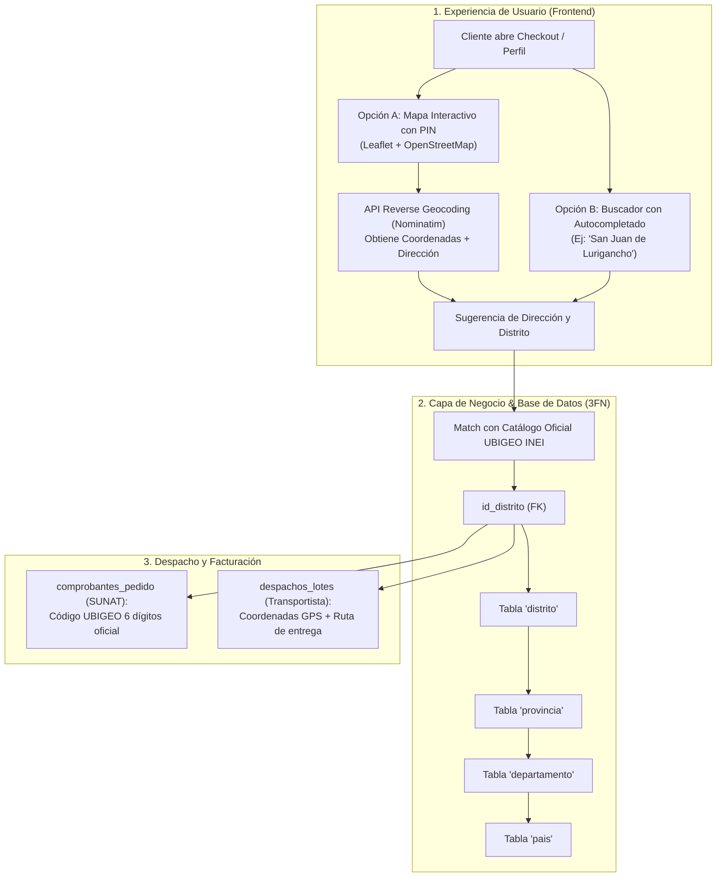

# Propuesta Técnica: Integración Híbrida de UBIGEO (3FN) y Mapa Interactivo (Delivery)

> **Documento de Diseño Técnico & Arquitectura**  
> **Proyecto:** TechStore (E-commerce Tecnológico)  
> **Cátedra:** Ing. Jeyson Junior Ventura Aguilar (UTP)  
> **Estado:** Documentado para futura implementación

---

## 1. Visión General y Justificación Arquitectónica

Para resolver la selección territorial de entrega sin sacrificar la **Tercera Forma Normal (3FN)** ni la **Experiencia de Usuario (UX)**, se propone una **Arquitectura Híbrida**:

---

## 2. Los Dos Componentes Clave

### A. Catálogo Oficial UBIGEO (Base de Datos Relacional 3FN)
* **Objetivo:** Cumplir con la normativa legal de comprobantes de pago de la **SUNAT** (Guías de Remisión y Facturas electrónicas exigen el código UBIGEO de 6 dígitos del INEI).
* **Estructura en BD:**
  * `pais` (id_pais, nombre_pais)
  * `departamento` (id_departamento, nombre_departamento, id_pais)
  * `provincia` (id_provincia, nombre_provincia, id_departamento)
  * `distrito` (id_distrito, ubigeo_codigo [VARCHAR(6)], nombre_distrito, id_provincia)
* **Volumen:** 25 departamentos, 196 provincias, 1,874 distritos del Perú.
* **Costo:** Cero (datos públicos y estáticos del INEI).

---

### B. Mapa Interactivo con Geocodificación Inversa (Frontend UX)
* **Objetivo:** Facilitar al cliente marcar su ubicación exacta sin tener que recordar códigos o nombres complejos de zonificación, proveyendo coordenadas precisas para el motorizado de reparto.
* **Librerías recomendadas (100% Gratuitas y de código abierto):**
  * **Visualizador:** `leaflet` y `react-leaflet` (liviano, sin cuotas ni límites).
  * **Tiles / Capas:** OpenStreetMap (`https://tile.openstreetmap.org/{z}/{x}/{y}.png`).
  * **Reverse Geocoding:** API pública de **Nominatim OpenStreetMap** (`https://nominatim.openstreetmap.org/reverse?lat={lat}&lon={lon}&format=json`).
* **Flujo de interacción:**
  1. El usuario hace clic en *"Seleccionar en el mapa"*.
  2. Mueve un pin o da clic en su casa.
  3. El frontend consulta Nominatim y extrae la calle, número y sugerencia de distrito.
  4. El sistema autocompleta el formulario y pide confirmación rápida: *"¿Confirmas entrega en: Av. Las Flores 450, San Juan de Lurigancho? [Aceptar]"*.

---

## 3. Plan de Implementación Futuro (Paso a Paso)

| Paso | Tarea | Detalle Técnico |
| :---: | :--- | :--- |
| **1** | **Carga SQL de UBIGEO** | Script `ubigeo_peru_completo.sql` insertando los departamentos, provincias y distritos con sus códigos INEI. |
| **2** | **Endpoint de Búsqueda** | Endpoint en Spring Boot `GET /api/ubigeo/distritos?busqueda={query}` con caché y paginación rápida. |
| **3** | **Instalación de Leaflet** | `npm install leaflet react-leaflet @types/leaflet` en `tienda_web_frontend`. |
| **4** | **Componente ModalMapa** | Componente reutilizable `SelectorMapaUbicacion.tsx` que emite `{ direccion, distrito, lat, lng }`. |
| **5** | **Integración en Carrito y Perfil** | Integrar el botón *"Elegir en mapa"* en `Carrito.tsx` y en la gestión de direcciones de `MiCuenta.tsx`. |

---

## 4. Argumentos para Sustentación ante el Docente

> 1. *"Mantenemos la **Tercera Forma Normal (3FN)** al 100% porque la orden de compra y el comprobante legal se amarran estrictamente al identificador `id_distrito` del catálogo formal, sin dependencias transitivas ni redundancia textual."*
> 2. *"Separamos la **vista logística** (coordenadas GPS y mapa para despacho físico) de la **vista tributaria** (código UBIGEO formal de 6 dígitos requerido por SUNAT)."*
